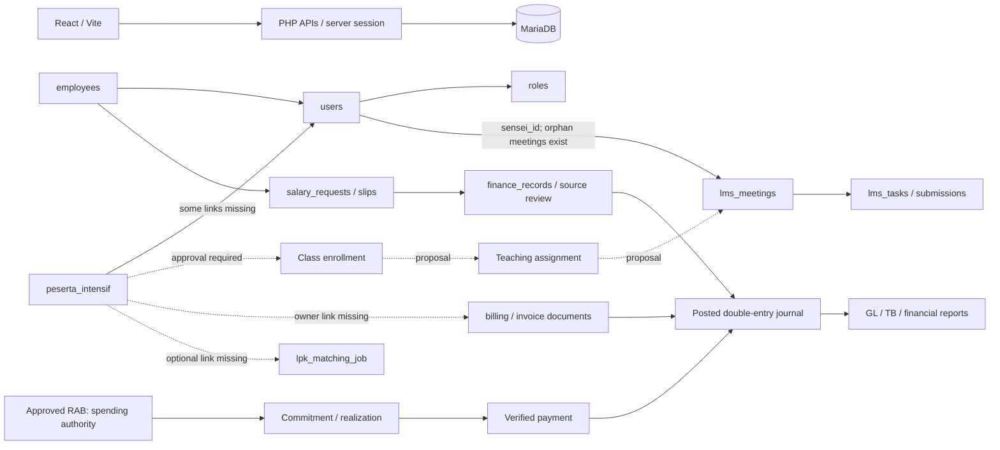

# ONE Creativa — audit Phase 5–16

> **Pembaruan release 12 Oktober 2026:** status terbaru ada di [PRODUCTION_READINESS.md](PRODUCTION_READINESS.md), [release-verification.json](release-verification.json), dan [QA_PHASE_5_16.md](QA_PHASE_5_16.md). Bagian di bawah menyimpan baseline dan hasil tahap sebelumnya; label pending/proposal historis tidak mewakili implementasi terbaru. Dua belas tabel additive sudah diterapkan lokal dengan restore verification; histori dan tujuh identity mapping belum diubah. Production tetap NO-GO sampai data, rekonsiliasi dan UAT target terbukti.

Audit awal 12 Oktober 2026, read-only pada koneksi lokal `localhost / one-creativa`; branch `main`, working tree sudah berisi perubahan sebelum pekerjaan ini. Tidak ada data bisnis dihapus, direcovery, atau dipindahkan. Kredensial dan nama/alamat pribadi tidak disalin ke laporan. Bukti awal: `phase5-readonly.json`, audit Finance Phase 2, inventory routes/API, dan backup private lokal Phase 2.

## Arsitektur dan bukti awal

React/Vite → proxy `/api` → Apache/PHP procedural → MySQLi/MariaDB. Tidak ada ORM atau controller framework. `employees.php` mencampur employee directory dengan akun system/LMS. `users.role_id → roles`, `employees.user_id → users`, `employees.department_id → departments`; jabatan adalah nama teks, bukan FK positions. Password akun memakai hash; jalur lama masih menyediakan password default dan mendukung MD5 saat login. Route guard menggunakan localStorage sehingga keputusan keamanan harus selalu di backend.

Finance Phase 2 mempunyai COA, periode, bank, journal header/lines, transaksi, sumber dokumen/alokasi, vendor bill, RAB commitments/realizations, permission konfigurasi dan audit immutable. Laporan menggunakan posted journal. Bukti sebelumnya 99 accounting + 75 budget + 68 salary checks, build/lint/syntax, serta preservasi semua nilai asli di 45 tabel. Ini bukti lokal sebelum Phase 5; regression setelah perubahan dicatat terpisah.

### Penjelasan employee loading dan data yang tidak tampil

Database lokal masih memiliki **8 employee profiles** dan **9 users**. SQL GET employee existing berhasil, mengembalikan **3** baris. Filter default hanya `karyawan/employee`, sehingga Finance, Sensei, dan profil siswa tersaring; INNER JOIN users juga menutupi satu profil orphan. Tidak ada filter company/branch atau soft-delete di skema/query itu. Delapan profil terdiri atas 3 karyawan, 1 Finance, 1 Sensei, 2 siswa, dan 1 relasi user putus. Ada satu akun karyawan tanpa employee profile. Data asli 45 tabel cocok dengan backup Phase 2, sehingga tidak ada bukti penghapusan baru akibat refactor Finance.

Frontend menggunakan satu `errorMessage` untuk list dan modal; kegagalan list ikut terlihat dalam modal baru. Error HTTP disederhanakan menjadi “Data employee gagal dimuat”, respons salah bentuk berubah menjadi array kosong, dan satu kegagalan metadata membatalkan seluruh Promise.all. Edit menghilangkan `is_active/join_date`, save tidak memeriksa status JSON, backend mengabaikan join_date/phone, dan status employment disimpulkan dari role. **Insiden pengguna belum direproduksi di hosting/browser**; SQL lokal sukses bukan bukti environment hosting sama. Perbaikan tidak diklaim menyelesaikan root cause hosting yang belum diketahui.

## Tabel temuan dan prioritas

| Module | Feature | Current Status | Problem | Root Cause | Priority | Fix | Test Result |
| --- | --- | --- | --- | --- | --- | --- | --- |
| HRD | Existing employee retrieval | PARTIAL | 8 profile → 3 default rows; 1 orphan tersembunyi | Filter login role dan INNER JOIN; shared error state | P1 | Pisahkan staff directory dari akun siswa; tampilkan orphan untuk review tanpa recovery otomatis; error per operasi | Read-only SQL sukses; regression perbaikan pending |
| HRD | Create/edit/status | FAIL | Default password, field tanggal/phone diabaikan, edit mereset active, SQL/JSON error tidak konsisten | Validasi/save UI dan API tidak lengkap | P1 | Transaction, validasi FK/role/field, password wajib, respons ID, audit, isolated tests | Source confirmed; perbaikan pending |
| Security | Employee/profile object access | FAIL | Direct API tanpa sesi/izin; salary/private profile dapat terbaca; role escalation | Guard frontend dianggap cukup | P1 | Backend sesi/CSRF/role/object guard, deny Finance employee directory, self profile, privileged role protections | Source confirmed; security regression pending |
| HRD | Resignation/history | FAIL | DELETE membuang payroll, attendance, student dan teaching data; FK checks dimatikan | Manual destructive cascade | P1 | Tolak physical delete; status inactive lewat update menjaga sejarah | Source confirmed; perbaikan pending |
| HRD | Salary structure/payroll/payslip | PARTIAL | Workflow Finance teruji tetapi employee edits belum terhubung audit; HRD tidak mempunyai permission finance | Role boundaries dan snapshot salary terpisah | P2/P3 | Regression salary; preserve immutable paid snapshot; konfigurasi business role sebelum perluasan akses | 68 checks sebelumnya; rerun pending |
| HRD | Attendance/leave | FAIL | Request identity/approval berasal dari client; dua tabel leave berbeda | Endpoint lama belum memakai session/object authorization; KPI membaca leave_requests sementara UI memakai leaves | P1/P3 | Perbaiki guard dan source KPI secara bertahap tanpa mengubah history | Read-only counts dan source confirmed; E2E belum diuji |
| Finance | Ledger/journal/RAB/reports | PARTIAL | Jalur baru teruji; legacy dan saldo awal belum direkonsiliasi | Historical records tidak boleh autopost; belum ada external reconciliation | P2 | Pertahankan coverage; review sumber historis dengan persetujuan | 242 checks sebelumnya; rerun pending |
| Security | Actual role identifiers | PARTIAL | `hr_admin/finance_admin` berbeda dari label HRD/Finance; Director belum ada | Identifier DB vs alias/UI dan konfigurasi belum selaras | P1/P3 | Daftar role aktual pada JSON; jangan mengarang role atau mengubah existing permissions diam-diam | Read-only 13 roles |
| Sensei | Assigned students/classes | FAIL | Global 5 students; kedua meetings tanpa teacher valid | Tidak ada enrollment/assignment entity; sensei_id orphan | P4 | Desain migration + explicit assignment dari administrator; tidak infer dari nama/email | 2 meetings missing valid teacher; migration membutuhkan approval |
| Sensei | Attendance/schedule KPI | PARTIAL | Attendance global; trend distinct learner bulanan; timezone PHP belum explicit | Scope SQL global, tidak ada enrollment, current-week period tidak konsisten | P4 | Dashboard dari enrolled students + assigned sessions; comparator unavailable jelas | 0 attendance aktual; E2E assignment belum mungkin |
| LMS | Student identity/personal scope | PARTIAL | 3/5 student records tanpa valid account; submission orphan | Legacy peserta IDs vs user IDs; tidak ada enrollment FK | P5 | Proposal relasi explicit; daftar orphan, no auto merge/recovery | 3 students + 1 submission orphan |
| LMS | `/dashboard-siswa-intensif` | FAIL | Target masih membaca agenda/task/student dari localStorage | Phase 2 memperbaiki `/lms/dashboard`, target berbeda | P5 | Hubungkan target ke shared enrolled LMS API setelah relasi disetujui | Source confirmed; belum browser QA |
| LMS | Assignment/grades/quiz/UKOM | PARTIAL | Sebagian API session/teacher ownership; roster/courses global; publish status belum ada | Enrollment dan draft/published grade belum dimodelkan | P5 | Explicit enrollment, publication, deadline/upload/idempotency tests | Guard subset teruji Phase 2; complete flow belum verified |
| LMS/Finance | Student bills | NOT IMPLEMENTED | Invoice tidak mempunyai FK student; bill dashboard belum aman dihubungkan dengan nama/email | Dua invoice systems, personal source relationship belum ada | P5 | Additive student document link dengan review; receipt submission vs verification tetap terpisah | 0 invoice aktual; jangan fabricate bills |
| Matching | Candidate/student identity | PARTIAL | Kandidat tanpa student FK, LPK sender teks, verification/history belum ada | CRUD mandiri, tidak ada status history | P6 | Optional FK internal student + external sender; duplicate checks, private documents, status history | 1 kandidat; 0 duplicate email; E2E belum verified |
| Matching | Authorization/uploads | FAIL | API tanpa session; runtime DDL; uploads tidak private | Legacy standalone endpoint | P1/P6 | Session/role/CSRF terlebih dahulu; migration + private delivery sebelum complete flow | Source confirmed; fixes pending |
| Database | Integrity/recovery | PARTIAL | Orphan ada sebelum Phase 5; missing FK di LMS/Matching/billing | Entity sources berbeda; sejarah existing tidak boleh diganti otomatis | P0/P7 | Reconciliation report + reviewed mapping, additive migration, approval before applying | Counts + hash evidence; no repair executed |
| UI/API | Error/loading/retry | PARTIAL | Generic errors, empty fallbacks, fake zero, SQL errors tersebar | Legacy handlers berbeda | P1/P7 | Mulai employee; request IDs, strict envelopes, separate loading/error/success | Employee improvements pending; seluruh aplikasi belum certified |
| QA/UAT | Application readiness | NOT VERIFIED | Browser/mobile/hosting QA dan approval bisnis belum tersedia | Local isolated tests bukan deployment/UAT | P7 | Manual matrix dan automated HTTP tests, final security/reconciliation | Belum ready production |

## Reconciliation dan risiko

| Issue type | Affected count | Module | Root cause | Risk | Suggested correction | Verification |
| --- | --- | --- | --- | --- | --- | --- |
| Employee → user orphan | 1 | HRD | user_id tidak cocok dengan users existing, meskipun FK tercatat | High | Administrator menentukan pemilik akun; jangan membuat user dari tebakan | SELECT LEFT JOIN; cocokkan backup/dokumen |
| Student → account missing | 3 | LMS | user_id null/missing | High | Explicit identity mapping setelah konfirmasi admin | SELECT LEFT JOIN + account ownership review |
| Meeting → teacher missing | 2 | Sensei | sensei_id tidak cocok dengan user existing | High | Mapping teaching assignment reviewed; preserve old meeting | Compare assignment source, jangan derive dari grade |
| Submission → user missing | 1 | LMS | siswa_id berbeda/tidak ada di users | High | Review namespace/identity; no auto conversion | Original submission, peserta/user mapping |
| Duplicate employee identity/student email/attendance/submission/matching email | 0 each | Shared | Tidak ditemukan pada query lokal yang diperiksa | Low for this snapshot | Tetap validasi dan constraint untuk future writes | Query groups in `phase5-readonly.json` |
| Unbalanced posted journals | 0; 0 posted journals | Finance | Belum ada posting operational | High if treated as complete accounts | Review legacy/saldo awal dan external reconcile | TB/GL/report coverage; bukan menyimpulkan bisnis tanpa profit |
| Timezone | DB Asia/Bangkok/SYSTEM; salary explicit Asia/Jakarta | Shared | PHP LMS menggunakan timezone default | Medium | Explicit business timezone saat APIs diperbaiki; test boundary dates | Compare DB/PHP/JS actual period, jangan mengubah history |

Risiko P0/P1: employee hard delete dan direct endpoint access; credential/data leaks lewat error/private uploads; recovery salah namespace. Risiko deployment: frontend/backend harus kompatibel, migration target harus reviewed, storage/uploads harus dipertahankan. Backup lokal tersedia tetapi bukan bukti backup hosting. Tidak ada deployment/restore dilakukan.

## Urutan implementasi dan approval

1. P0 selesai audit read-only dan baseline hash; source backup terpilih sebelum edit.
2. P1 safe code fixes employee retrieval/form/authorization/no hard delete + session/private profile. Gunakan DB fixture sintetis, tanpa migrasi atau perubahan employee existing.
3. P2 regression finance/RAB/payroll, termasuk inactive session dan permission server; coverage tetap.
4. P3 attendance/leave authorization dan salary confidentiality sebelum memperluas akses HRD.
5. P4/P5 memerlukan additive enrollment/assignment/document link migration dan mapping reviewed. P6 identity/history juga membutuhkan migration. Siapkan desain reviewable dan minta approval sebelum menerapkan; tidak melakukan repair history dari email/nama atau “BATCH 2”.
6. P7 QA matrix security/business/mobile/hosting, data reconciliation dan UAT. Belum ada klaim PASS untuk alur tanpa bukti.

Instruksi pengguna yang membatasi tahap berikut: “For database migrations, employee recovery, historical transaction corrections, or any potentially destructive operations, stop and request approval first.”

## Perubahan dan bukti sesudah safe fixes

Tabel awal di atas merupakan baseline. Status sesudah implementasi lokal berikut hanya menyatakan cakupan pada kolom Test Result. PASS pada API/fixture bukan persetujuan browser/UAT atau produksi.

| Module | Feature | Current Status | Problem | Root Cause | Priority | Fix | Test Result |
| --- | --- | --- | --- | --- | --- | --- | --- |
| HRD | Retrieval / dropdown / error | PASS | Filter role/JOIN menyembunyikan staff/orphan, metadata failure terlihat sebagai modal failure | Query dan error state bercampur | P1 | LEFT JOIN, staff lintas role, scope LMS terpisah, strict response, meta/stats/list/form error terpisah, retry/correlation ID | API lokal: 6 staff including 1 orphan, 7 departments, 14 positions; SQL failure fixture tetap 500, list tidak ikut gagal; browser NOT VERIFIED |
| HRD | Create/edit/status/account/department | PASS | Default password; field hilang atau diabaikan | Validasi/transaction dan form init | P1 | Service baru, actual role/FK validation, date/phone exact, secure required password, no default role creation, numeric salary, preserve omitted edit fields, returned employee ID, inactive session denied | API/isolated tests: 78 HRD/security/upload checks + 12 UI checks; browser NOT VERIFIED |
| Security | Employee/private profile/salary | PASS | Direct API, object ID spoof dan restricted credential changes | Tidak ada backend guard | P1 | Session + CSRF + role/object guards; Finance/siswa tidak mendapat directory orang lain; HRD tidak mendapat financial read; LPK salary masked; profile tidak otomatis membuat employee | Jalur HTTP yang diuji: role/id spoof/401/403, own profile, no hashes; role alias hr_admin dikoreksi di route/navigation |
| HRD | History/resignation/audit | PASS | Physical delete dan hilangnya payroll/LMS/attendance | Manual destructive cascade | P1 | DELETE employee/attendance/position/candidate ditolak; inaktivasi melalui edit; audit existing immutable log di transaction | API/fixture: original timestamps/data preserved; failed audit rolls back; no original record updates |
| HRD | Attendance/leave | PARTIAL | Spoof role, global reads, double decision, fake shift, conflict history | Actor dari client; lock terlambat; worked timestamps fabricated | P1/P3 | Session/self scope; server reviewer role; request + employee lock; approved absence timestamps NULL; existing attendance conflict rollback; no self approval | Anonymous/self isolation/spoof/approval/retry/conflict tested; absence/face/RFID/overtime dan seluruh leave UI belum E2E |
| Finance | Approval policy | PASS | Admin dengan configure bisa menambah approval sendiri | Master permission mutation tidak membedakan policy vs COA | P1 | Hanya Super Admin mengubah role permission; configure COA tetap; form Izin mengikuti capability server; tidak mengubah rows existing | Backend/API: 5 regression tambahan; restricted approval + direct API bypass denied. Director account aktual belum tersedia |
| Finance | Journal/RAB/payroll/reports | PARTIAL | Legacy/saldo awal belum disertifikasi | Tidak boleh autoreclassify history | P2 | Accounting tidak ditulis ulang; balances/reversal/idempotency/coverage dipertahankan | Cakupan regression PASS: 104 accounting + 75 budget + 68 salary checks; reconciliation historis belum selesai |
| Matching | Guard / no runtime DDL | PASS | Anonymous candidate access dan delete | Endpoint standalone | P1/P6 | Admin/Super/LPK session + CSRF; Finance denied; table readiness explicit; no runtime DDL/GET mkdir; physical delete refused | Auth/read/direct API/delete fixture tested; cakupan business flow PARTIAL: candidate creation, documents/verification/progress/history masih pending |
| Sensei/LMS | Enrollment/assignment/dashboard/bills | FAIL | Target dashboard localStorage, global sources, absent FK relationships | Tidak ada class/enrollment/bill ownership; historical orphan | P4/P5 | Proposal additive relations disiapkan; tidak mengarang assignment/enrollment atau recover old records | `PROPOSED_RELATIONSHIPS.sql` review draft; migration NOT VERIFIED / NOT EXECUTED; detail fitur PARTIAL pada baseline |
| System | Ready for production/UAT | NOT VERIFIED | Masih ada endpoint legacy, UAT, reconciliation dan mapping | Cakupan lint/build/tests bukan full-system acceptance | P7 | QA matrix dan staged approval | Tidak ada deployment atau klaim seluruh aplikasi selesai |

### Files / APIs / schema

Added: `backend/services/employee_directory.php`, `backend/tests/employee_directory_test.php`, `src/utils/employeeApi.js`, `tools/employee-ui-test.mjs`, `tools/phase5-readonly-audit.cjs`, `tools/phase5-local-check.php`, serta dokumen audit/QA/proposal. Modified: employee, employee_stats, profile, upload_photo, attendance, leaves, positions, lpk_matching, accounting API; accounting_journal service; isolated test router/accounting tests; Employees/AccountingTools/App/roleAccess/sessionHeaders; scanner inventory. Source sebelum edit yang terpilih disimpan private di `backend/storage/backups/phase5-code-1791784625625`.

API employee GET mengembalikan envelope success dan request ID, POST/PUT mengembalikan `data.id/user_id`; GET `view=meta` mengambil role/departemen/jabatan asli. PUT mengaktifkan/menonaktifkan akun bersama employee edit. DELETE ditolak 409. Pembacaan dan pengubahan memakai sesi yang masih active serta CSRF untuk mutation. Password/PIN hash tidak diserialisasi. Ledger/financial policy API menambah capability `configure_roles`; bukan role/permission row baru.

**Tidak ada migration Phase 5 diterapkan dan tidak ada recovery, employee mutation, assignment repair, credential reset, atau historical correction di database operasional.** Mutations pada tests hanya database sintetis yang dibuang runner. Audit employee membutuhkan `accounting_audit_logs` existing; jika belum tersedia di target, write ditolak 503 sampai setup/migration disetujui. Skema employee existing hanya mendukung WFO/WFH, NIK/phone 20 karakter; opsi Hybrid yang tidak didukung dihapus dari form. Employment type/manager terpisah dari login role dan menunggu schema proposal, tidak disimpulkan dari role.

### Testing evidence

- `php backend/tests/employee_directory_test.php`: 78 checks — HTTP sesi/CSRF/cross role/inactive/profile, create/edit/dept/decimal/hash, no physical delete, audit rollback, real reviewer leave, absence NULL timestamps, conflict rollback, protected Matching, actual MIME photo extension, old photo preserved, master SQL failure + correlation ID.
- `php backend/tests/accounting_test.php`: 104 checks, termasuk Admin tidak dapat menambah approval sendiri melalui service/API.
- `php backend/tests/budget_workflow_test.php`: 75 checks; `php backend/tests/salary_workflow_test.php`: 68 checks.
- `node tools/employee-ui-test.mjs`: 12 checks, inactive/join_date/phone/decimal/password initialization, strict envelopes dan role alias/error ID.
- Total **325 integration checks + 12 UI checks = 337**. PHP syntax, targeted ESLint enam file frontend, Vite production build, dan generated SW/private packaging check lolos. Build memakai output sementara dan tidak mempublish `dist`/hosting. Warning bundle export besar dan Browserslist data lama tetap ada.
- `node tools/phase5-readonly-audit.cjs --output docs/audit/phase5-after.json` dan `php tools/phase5-local-check.php`: koneksi dan query aktual, tanpa executing database config DDL; `phase5-verification.json` membandingkan row hash seluruh **61 tabel** sebelum/sesudah.
- `node tools/phase2-data-integrity.cjs`: seluruh nilai asli **45 tabel** tetap sama dengan backup Phase 2.
- Inventory terbaru: 103 routes, 74 API PHP, 25 nondiagnostic endpoints tanpa detected session authorization, 15 endpoints dengan runtime DDL termasuk helpers. Flag static bukan exploit certification; angka terbaru berbeda dari snapshot Phase 2 sebelum perubahan ini.
- `git diff --check` pada file perubahan tahap ini lolos. Pemeriksaan seluruh working tree masih menemukan trailing whitespace pada file di luar tahap ini; perubahan pengguna sebelumnya tidak diformat ulang.

Log error baru memakai correlation ID dan kelas/kode error, respons server tidak memasukkan SQL atau kredensial. Tidak ada log hosting yang tersedia untuk mengaitkan insiden pengguna; kegagalan session path pada percobaan awal test adalah pembatasan sandbox fixture, diperbaiki dengan session temp directory test, **bukan root cause incident pengguna**.

### Risiko tersisa / next exact action

Audit exhaustive runtime seluruh aplikasi belum selesai: banyak endpoints, employee recovery, assignment/enrollment, quiz/UKOM publication, student bills, candidate source/documents/history, face/RFID, HRD UI penuh dan browser/mobile perlu pengujian. Legacy public attachments, MD5-compatible login, serta dua invoice/leave sources perlu follow-up. Permission identifiers yang belum dipetakan (misalnya finance_admin) tidak diberi financial rights diam-diam. Kandidat external tetap tidak dipaksa mempunyai internal student.

Langkah berikut yang membutuhkan approval adalah proposal sembilan tabel kosong pada `PROPOSED_RELATIONSHIPS.sql`, target development lokal saja, dengan versioned migration/preflight/test/backup/restore verification terlebih dahulu. Mapping/recovery tujuh relasi bermasalah tetap memerlukan keputusan identitas tersendiri; approval schema tidak berarti approval auto-recovery. Rincian rollback/dependencies pada `NEXT_PHASE_APPROVAL.md`; QA matrix pada `QA_PHASE_5_16.md`.

## Verifikasi kandidat release terbaru ? 12 Oktober 2026

489 pemeriksaan lokal lulus: 105 accounting, 75 budget, 68 salary, 78 employee, 49 relationships/learning/billing/Matching, 102 HTTP nyata dan 12 state UI. PHP syntax 141 file lulus; lint 183 file tanpa error, dengan 21 warning Hooks; final build dan package checks lulus. Kandidat release 294 file mempunyai manifest SHA-256. Semua 61 tabel awal dipertahankan setelah schema lokal menjadi 73 tabel.

Production tetap **NO-GO**: tujuh mapping historis, hubungan kelas/owner operasional, rekonsiliasi Finance, browser/staging/perangkat/UAT dan beberapa workflow harus ditutup. Rincian serta evidence otoritatif ada di [readiness](PRODUCTION_READINESS.md), [verification](release-verification.json), [QA](QA_PHASE_5_16.md), dan [runbook](PRODUCTION_RUNBOOK.md). Tidak ada deployment hosting.
