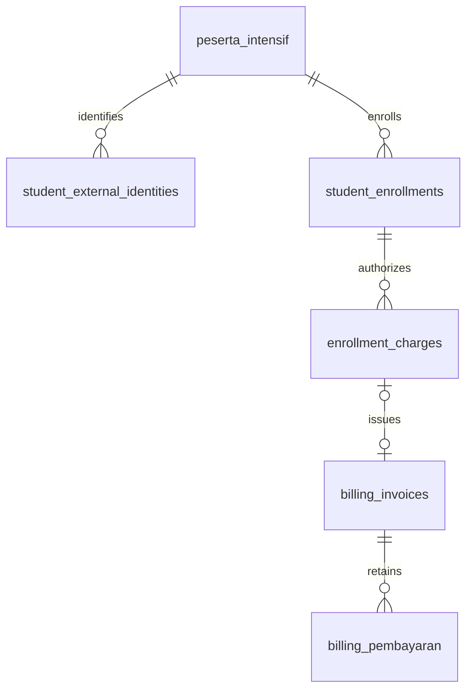

# BE-03 — Enrollments, authorized charges, and invoice numbering

## Status and deployment gates

Implemented in the working tree on `feat/backend-finance-workflow`; no production
migration, notification, commit, or push is part of this work. Fixture tests do
not establish production readiness.

**Not ready for production until all of these dependencies are resolved:**

- Upstream/PIC confirms person identity and enrollment-occurrence identity and
  forwards both explicitly. Existing `id/web_id` semantics are unproven.
- Finance supplies real approved pricing **and charge policies**. The application
  catalogue remains empty; test approvals must never be deployed.
- Finance/DB PIC reviews the migration against actual indexes, engines, ID types,
  legacy data conflicts, and reconciliation workload, then approves the release.
- Official bank masters, including verified account holders, support the accounts
  referenced by auto-issue policies. Bank validation is shared with Finance now;
  the webhook no longer issues using a hardcoded bank template.
- n8n and other upstream consumers adopt the explicit identity, server invoice
  number, review, replay, and delivery guards described below.

## Inspection evidence and identity contract

`sync_students_web.php` reads the upstream `participants` list. The supplied
`automation/n8n-phase1-invoice-workflow.json`, node “2. Normalisasi Data & Skema”,
forwards `Number(s.id || s.web_id || 0)` as `student.id`, defaults program and
payment scheme, and does not forward a distinct enrollment ID. Repository code
does not prove whether this upstream ID denotes a person or a registration.
No production data or upstream production endpoint was accessed to infer it.

Consequently **neither `web_id`, old `registration_key`, NIS, name, email, phone,
nor a program substring is enrollment identity**. The new trusted-source contract
is explicit:

```json
{
  "student": {
    "external_student_id": "authoritative-person-id",
    "external_enrollment_id": "authoritative-registration-occurrence-id",
    "nama": "Nama siswa",
    "program": "Intensif Offline",
    "skema": "Full Payment",
    "total_biaya": "exact-decimal-assertion",
    "batch": "authoritative-cohort-if-available"
  }
}
```

This illustrates identity fields, not a valid price example. Source namespace
`creativabridging.com` is fixed server-side by the authenticated integration.
Client-selected source namespaces are rejected. External IDs are case-sensitive,
nonempty strings up to 191 characters, without surrounding whitespace (positive
integer IDs can be forwarded without losing precision). No float conversion is
permitted for identifiers. Use JSON strings for large upstream IDs.

An explicit NIK from this trusted source can resolve a person if a distinct
external person ID is unavailable. Conflicting/ambiguous NIK mappings fail with
409. A NIK does **not** replace the enrollment-occurrence ID. Unverified contacts
never merge people. The person mapping internally namespaces person IDs as
`student:<id>` and NIK fallback as `nik:<value>`; no global uniqueness on student ID
is imposed, so multiple verified external identities may resolve to one student.

Old `id/web_id` is retained only as an opaque observation in the registration
audit, not assigned new enrollment meaning or used to overwrite `web_id`.
Missing person identity is audited without creating a guessed student. If a
person is resolvable but enrollment identity is missing, safe identity fields can
be saved, with `missing_upstream_enrollment_identity`, no enrollment, no invoice,
and no delivery payload. A new verified occurrence ID is required for each truly
different enrollment; changing program/cohort under an approved occurrence ID
requires review rather than silently creating another bill.

## Normalized model



The diagram describes relationships; legacy payment tables are not altered or
assigned new foreign keys by this migration.

| Table/view | Purpose and constraints |
| --- | --- |
| `student_external_identities` | Maps authoritative source/person keys to `peserta_intensif.id`; UNIQUE(source, external_student_id), student FK RESTRICT. |
| `student_enrollments` | Exact source/occurrence, student FK RESTRICT, canonical program, cohort, payment scheme, approval/review status/reason, immutable approved pricing JSON/hash, timestamps. UNIQUE(source, external_enrollment_id); ordinary student index. |
| `enrollment_charges` | Approved business charge and policy JSON/hash, exact DECIMAL amount, optional issued invoice FK RESTRICT. UNIQUE(enrollment_id, charge_type, charge_key); UNIQUE(billing_invoice_id). Many charges/invoices per enrollment. |
| `invoice_sequences` | Server monthly `TGCJYYMM` prefix and next number, one locked row per prefix, bounded at 10000 sentinel. |
| `enrollment_invoice_reconciliation` | Read-only view of invoices without an authoritative charge link, marked `needs_review`; does not rewrite legacy rows. |

There is **no UNIQUE(student_id) or UNIQUE(enrollment_id) on invoices/charges**.
One charge consumes at most one official invoice; schedules within that invoice
remain metadata and do not create more invoices.

Existing `peserta_intensif` program/payment/price fields remain. A later enrollment
does not overwrite the person's existing operational program/fee/batch/status, and invoice
pricing never reads those global fields as the new charge authority. Incoming
cohort/status observations remain in the enrollment header/audit. Unmapped legacy
contact collisions require reconciliation without assigning ownership. New people
may retain their first confirmed operational fee for compatibility. Each
enrollment retains its own approved rule snapshot, including charge policies.

## Charge authorization and pricing snapshots

BE-02 catalogue validation remains in `student_pricing.php`; shared aliases stay
in `payment_schemes.json`. No Finance-approved rule is added to application JSON.

An approved program rule may contain an explicit `charges` list. **Absence means
no billable charge authorization**, even if the program price itself is approved.
Every configured charge requires:

- `type`: supported identifier `program_fee`, `registration_fee`, or
  `additional_fee`. These are implementation identifiers, not active products.
- `key`: a fixed Finance-approved occurrence key (1–100 ASCII letters, digits,
  underscores or hyphens). Each authorized repeated occurrence must be listed
  separately. Request-generated/random keys have no authority.
- `label`, exact positive `amount`, zero `discount`, `scheme`, and exact
  `installments` with labels/amounts/relative `due_days`, validated as in BE-02.
- Its own `approval.status=approved`, reference, approver, and date. A program
  pricing approval does not implicitly authorize additional charge types/prices.
- Explicit boolean `webhook_issue`. At most one initial charge is auto-issued
  per webhook result, preserving the existing one-invoice result envelope.
  Other approved charges remain available to Finance. This is an API limitation,
  not a one-invoice-per-enrollment business rule.
- `bank_account_id` when auto-issue is enabled, resolving to the same complete
  official bank/COA master required by BE-01.1. No bank fallback is synthesized.

A `program_fee` must match its parent rule's price, scheme and term schedule;
other charge types require their independent explicit policy. No percentages,
splits, due dates, fee products or discounts are inferred.

When a new enrollment becomes approved, the service freezes the normalized rule
and materializes exactly its approved charge identities/policies. The database
enforces `(enrollment_id, charge_type, charge_key)` uniqueness. Finance selects a
server `charge_id`; optional type/key request fields are assertions only. A
different `charge_id` from another enrollment or conflicting ownership fails.
There is no public API to create charge authorizations from arbitrary amounts.

Snapshots include approval references and hashes; issued invoices retain student,
enrollment and charge IDs, policy hashes and approval provenance in metadata and
audit. Integrity and ownership are rechecked before issue/link/reconciliation.
An approved snapshot is not repriced when a later catalogue rule changes. New
enrollments use current approved policy; existing authorized charges use their
captured approval. Removing a catalogue entry does not revoke historical frozen
authorizations. A revocation/cancellation/replacement workflow requires Finance
policy; do not edit snapshots or invent replacement occurrence keys to simulate it.
Incoming conflicting assertions set a review reason and prevent new issuance.

The minimal lifecycle is unresolved/review → approved enrollment with authorized
charges → issued charge. Academic completion, withdrawal, replacements and
approval revocation are not inferred from legacy student-status labels. Already
cancelled/voided invoice charges remain consumed: replay returns that invoice and
status, never a replacement. Any further lifecycle actions require explicit policy.

## Transactions, deduplication, and numbers

Both `billing.php?action=add_invoice` and the authenticated registration webhook
call `billing_issue_charge`; only that service inserts official invoices.
Finance retains prepare permission, session/CSRF protection, initial Unpaid,
exact monetary/metadata validation, complete official bank master and audit.
The webhook uses its authenticated integration actor and approved auto-issue
bank policy. Sync never issues invoices.

Registration serializes the same trusted person mapping and locks its exact
enrollment in a transaction. Issuance locks student → enrollment → charge. Only
an unconsumed, approved charge can allocate a number and create an invoice.
The committed invoice ID is recorded on the charge in the same transaction as
invoice insertion and audit. Same-charge retries return the existing invoice,
including Paid/Cancelled statuses, without touching invoice/payment history.

Numbering uses the server's Asia/Jakarta issuance month, regardless of the
invoice's user-selected document date. `INSERT IGNORE` establishes a sequence
row, then `SELECT ... FOR UPDATE` serializes the counter update. The invoice ID
remains `TGCJYYMMXXXX`, starting at 0001. Existing collisions are skipped and the
invoice primary/unique key remains the final safeguard. Month/year changes use
another prefix. At 9999 the period is exhausted: new issuance fails 409; numbers
are not recycled or silently extended to five digits. Existing-charge replay
does not allocate another number.

Sequence initialization from legacy canonical numbers occurs only in the
explicit migration, using the existing maximum as a high-water mark. Runtime
issuance no longer uses an unprotected MAX+1. Disable old writers during rollout;
an old deployment must not keep issuing outside the new allocator.

Audit/SQL failure rolls back invoice, charge consumption and transactional
counter. An uncommitted candidate can be reused because no successful response
was returned. Auto-increment internal IDs can have normal rollback gaps. MySQL
1205 and deadlock/uniqueness conflicts return 409 after rollback where applicable;
clients reconcile the stable charge before retry. Read failures never authorize
a second invoice. Committed official charge invoices cannot be deleted through
the legacy invoice-delete action; enrollment-bearing student deletion also fails
with a review message, preserving the new relationships.

## API and frontend contract

Session/CSRF requirements and success/error envelopes are unchanged. New Finance
creation payload:

```json
{
  "action": "add_invoice",
  "student_id": 123,
  "enrollment_id": 456,
  "charge_id": 789,
  "bank_account_id": 7,
  "tanggal": "2026-11-13",
  "jatuhTempo": "2026-11-20",
  "total": "15000000.50",
  "status": "Unpaid"
}
```

Amounts/dates here illustrate a synthetic test contract, not an approved policy.
The server compares them against the charge snapshot. **Omit `id`**; sending a
client invoice number returns 422. Status must be omitted or Unpaid. Existing
discount/item/subtotal validations remain; schedule is generated from the charge
policy or checked exactly if supplied. The first due date must match the approved
offset from document date. Client payment flags never enter invoice metadata.

Success returns `data.id`, `student_id`, `enrollment_id`, `charge_id`,
`created_now` and actual invoice `status`. Same-charge replay is HTTP 200 with
`created_now=false`, not a duplicate-number error. Ownership/conflicts/review or
overflow return 409; unknown student/enrollment 404; invalid/forged charge or
assertions 422; authentication/permission remain 401/403. Audit failure returns
500 after rollback.

`GET /api/billing.php?view=charge&student_id=123&enrollment_id=456&charge_id=789`
returns `data.invoice=null` or an owner-checked invoice identity/status. This is
the retry/reconciliation key; no guessed invoice number is needed.

`accounting.php?view=lookups` adds `enrollment_schema_ready`, `enrollments` and
`charges`. Enrollments retain student ID, program label, cohort and review state.
Eligible charge rows supply charge type/key, amount, label, scheme, approved
relative term schedule, and any existing invoice ID. Missing migration yields
empty eligibility and a false readiness flag, not fallback pricing.

The wizard explicitly selects student → enrollment → approved charge. Program,
price, discount and terms are read-only snapshots; changing document date derives
the approved due dates with exact decimal amounts. Several enrollments never
collapse to a global student price. No approved charge means no issuance.
Manual-student UI and honest unsaved draft behavior remain. Preview shows that
the server supplies the official number; downloaded previews are labelled
PRATINJAU. No synthetic payment/delivery rows or local official invoice are saved.

After an uncertain POST, the FE checks the same charge. A confirmed existing
invoice may complete reconciliation with `created_now=false`; otherwise explicit
retry checks again before posting. Unavailable reconciliation blocks retry.
Student/enrollment/charge changes are blocked while resolving uncertainty; the
FE never generates a fresh invoice number or random charge key to bypass it.

Webhook results add enrollment/charge IDs, type/key and server invoice number.
Pricing/enrollment review returns no invoice/URLs/messages and
`needs_delivery=false`; it cannot trigger redispatch just by returning success.
Recognized invoice replays also set `needs_delivery=false`. Sync uses the same
identity/snapshot rules, adds enrollment IDs to review entries, and never issues
an invoice. An HTTP 200 registration review is identity processing success,
not proof that a bill was issued.

## Versioned migration, preflight, rollback and recovery

Migration: `backend/migrations/20261113_finance_enrollments.php`, implemented in
`backend/services/enrollment_schema.php`, version `finance_enrollments_v1` with
checksum in the existing migration ledger. Included in the normal release-copy
allowlist; it is CLI-only and is never called by HTTP creation/lookup paths.

Commands for **PIC review and a controlled deployment**, not executed against
production in this task:

```text
php backend/migrations/20261113_finance_enrollments.php --dry-run
php backend/migrations/20261113_finance_enrollments.php --apply
php backend/migrations/20261113_finance_enrollments.php --rollback-empty
```

`--dry-run` prints the plan and exits before connecting. `--apply` is explicit.
The migration requires existing InnoDB parent tables, supported exact student ID
type and invoice collation/type, an existing unique invoice-ID index, and no
duplicate invoice IDs. It copies FK signedness/collation without altering parent
columns. Existing conflicting migration checksums fail. Required charge/source
uniqueness and restrictive ownership FKs are verified; an unexpected
one-enrollment-per-student/one-charge-per-enrollment constraint fails review.
Creation requires the completed migration marker, not merely partial tables.
DDL is idempotent, but
MariaDB DDL implicitly commits: take a verified backup and maintenance window;
rerun to recover a partial empty installation after fixing its cause.

Before production apply, PIC must inspect actual `SHOW CREATE TABLE`/indexes,
engines, nullable/invalid IDs, noncanonical invoice IDs, orphan historical links,
external-key conflicts, applicable collations, and retained audit/backup data.
These cannot be assessed from isolated fixtures. Do not convert ID types or add
student/enrollment uniqueness to existing invoice tables to force the migration.
No old invoices, payments, delivery records, source documents, student invoice
links, accounting entries, or audit rows are backfilled/deleted/repriced.

Recovery rules:

1. Before any BE-03 business rows exist, `--rollback-empty` may remove only the
   newly added tables/view/version marker, preserving parent billing/student
   tables. Seed-only sequence rows can be reconstructed from retained numbers.
2. Once any new identity/enrollment/charge row or enrollment invoice exists,
   rollback refuses destructive removal. Disable issuance, preserve schema/data,
   and forward-fix. Do not redeploy old MAX+1/random-number writers as recovery.
3. Restore a coordinated backup only through PIC's incident process, including
   all interdependent financial records. Never restore just the sequence table
   behind already committed invoices. Checksums/unique constraints and audit
   evidence must be preserved.

## Legacy reconciliation process

Historical invoice reads and invoice documents retain their existing IDs, tokens,
amounts, statuses and payment behavior. Billing reads add `enrollment_resolution`,
using actual relational ownership rather than accepting metadata IDs as proof.
Unlinked or conflicting legacy records show `needs_review`; the reconciliation
view supplies an explicit work list without changing history.

Finance/PIC must gather the original authoritative registration event/person
reference, documentary charge authorization and immutable invoice/payment
evidence. Names/email/NIS or approximate program matching alone are insufficient.
Compare exact owners, occurrence, amount, approved schedule and existing links;
record evidence and a reviewer decision. If the occurrence remains unprovable,
leave the historical invoice unlinked and readable. Never create a synthetic
enrollment/charge key to make the warning disappear.

For proven cases, prepare a separately reviewed, narrowly scoped correction
transaction: lock the exact invoice, student/enrollment and authorized charge;
check that neither charge nor invoice has another owner/link; preserve a before
snapshot; append only justified ownership/provenance and its relational link;
audit reviewer/evidence/old and new metadata. Preserve original amount, status,
dates, number, token and payments. Do not point a new charge at incompatible
historical pricing or fabricate a verified bank snapshot. This release deliberately
provides no bulk identity guessing or unaudited reconciliation endpoint.

## n8n / BE-02.1 / BE-04 boundaries

The supplied n8n workflow was inspected but not modified or silently replaced.
Upstream/PIC must:

- Remove default program/payment scheme/cohort assumptions from its normalization.
  Preserve actual values and exact decimal strings; forward both stable external
  person and enrollment IDs, without numeric coercion/precision loss.
- Confirm and document whether existing `participants.id` identifies a person
  or occurrence. If it identifies an enrollment, a separate verified person key
  is still required; simply copying it into both fields is not an approved fix.
- Use returned server `invoice_id` and charge IDs; never predict numbers. Check
  pricing review, `invoice_created_now`, `needs_delivery` and null results before
  entering delivery/PDF branches. A lost response retries the same source event.
- Implement explicit delivery acknowledgments and transport success checks in
  BE-04. A replay or review response must not itself resend WhatsApp/email.

Existing delivery logging semantics remain: new webhook invoices may still log
`Terkirim` without a real delivery acknowledgment, or `Menunggu Bot` when deferred.
This remains a **BE-04 issue**, not a completed delivery guarantee. The endpoint
constructs payloads but performs no external send. Receipt/payment/reminder
workflows and production secrets/environment are unchanged.

## Tests and changed files

The local runner creates disposable MariaDB databases and synthetic approvals;
all webhook tests defer delivery. Sync uses the existing test-only local fixture,
not an upstream fetch. Concurrency uses separate PHP processes and MariaDB
connections running the same business services, including registration callbacks;
HTTP routes are tested separately. This is not concurrent production HTTP E2E.

Required scenario mapping:

| Scenarios | Executable coverage |
| --- | --- |
| One enrollment/invoice; two enrollments; other program/cohort | `enrollment_billing_checks.php` |
| Two types; two verified keys of one type; same charge replay | `enrollment_billing_checks.php` |
| Concurrent same/different charge and cross-source numbering | `enrollment_billing_worker.php` + lifecycle checks |
| Forged enrollment, cross-owner, forged type/key, auth/CSRF | `billing_integration_checks.php` |
| Missing upstream identity, legacy unprovable enrollment | Lifecycle checks + billing read assertions |
| Unapproved/invalid pricing, exact decimals, full/cicilan, repeat sync | `pricing_registration_checks.php` |
| Snapshot preservation, Paid invoices and verified payments | Pricing + lifecycle checks |
| Network retry, no random number, correct enrollment selection | Utility + headless-browser tests |
| Audit and 1205 rollback, migration/empty rollback/legacy high-water mark | Security + lifecycle checks |
| BE-01/01.1/01.2/02 regression | Updated security, pricing, utility and browser suites; obsolete global-fee/client-number assumptions updated to the new contract |

Changed production files:

- `backend/services/enrollment_schema.php` (new)
- `backend/services/enrollment_billing.php` (new)
- `backend/migrations/20261113_finance_enrollments.php` (new)
- `backend/services/registration_sync.php`
- `backend/services/student_pricing.php`
- `backend/services/billing_invoice.php`
- `backend/services/student_billing.php`
- `backend/api/webhook_registration.php`
- `backend/api/sync_students_web.php`
- `backend/api/billing.php`
- `backend/api/accounting.php`
- `src/components/BuatInvoiceWizardModal.jsx`
- `src/utils/studentInvoice.js`
- `copy-backend.js` (migration packaging allowlist only)

Changed verification/documentation files:

- `backend/tests/billing_invoice_test.php`
- `backend/tests/billing_integration_checks.php`
- `backend/tests/pricing_fixture.php`
- `backend/tests/pricing_registration_checks.php`
- `backend/tests/enrollment_test_helpers.php` (new)
- `backend/tests/enrollment_billing_checks.php` (new)
- `backend/tests/enrollment_billing_worker.php` (new, CLI-only)
- `tools/student-invoice-test.mjs`
- `tools/student-invoice-browser-test.mjs`
- `docs/finance/BE-01-invoice-validation.md`
- `docs/finance/BE-02-pricing-registration.md`
- This document (new).

Commands: PHP syntax checks for all changed PHP files; local
`php backend/tests/billing_invoice_test.php`; `node tools/student-invoice-test.mjs`;
`node tools/student-invoice-browser-test.mjs`; ESLint changed JS/JSX;
`npm.cmd run build`; `git diff --check`. Final actual results are recorded below
after verification. The independent accounting suite has a known baseline COA
1100 fixture mismatch; it is not silently repaired as part of BE-03.

Verification on 2026-11-13 used a fresh local MariaDB datadir and disposable
databases, without accessing production or sending real notifications:

| Executed check | Actual result |
| --- | --- |
| Billing/enrollment integration | PASS: 197 assertions — 80 creation/security, 68 BE-02 pricing/registration, 45 lifecycle/concurrency/migration, 4 session/legacy checks |
| Utility regression | PASS: 24 mock-API scenarios |
| Headless browser regression | PASS: 15 mock-API scenarios |
| PHP syntax | PASS: all 18 changed/new PHP files |
| ESLint app/utility and two changed test scripts | PASS: no errors |
| ESLint `copy-backend.js` | Two existing errors at line 68 (`no-unused-vars`, `no-empty`); identical findings verified against HEAD, no new lint errors |
| `npm.cmd run build` | PASS; migration included in release copy without executing it |
| Migration CLI `--dry-run` | PASS; exits before DB connection |
| `git diff --check` | PASS |
| Independent `accounting_test.php` | FAIL: existing missing COA 1100 fixture at line 41; test/core/schema files unchanged |
| Production migration/E2E/delivery/actual Finance approvals | Not run or claimed |

The concurrency fixture uses independent banks and COAs across Finance/webhook
so a common bank lock does not substitute for testing the sequence allocator.
The original bank validator was compared with HEAD and is unchanged. Test-only
approvals are confined to temporary fixture files. The generated deployment ZIP
was restored to HEAD; the isolated database instance and temporary files were
cleaned up after verification. All implementation changes remain uncommitted.
