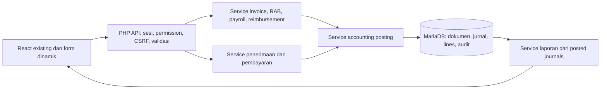

# Phase 1 — Audit Finance ONE Creativa

Tanggal laporan: 12 Oktober 2026, Asia/Bangkok.

**Hasil: aplikasi existing sudah memiliki pencatatan kas sederhana, approval RAB dan payroll, tetapi belum memiliki fondasi akuntansi akrual.** Persetujuan RAB menciptakan pemasukan, modal dihitung dalam laba, dan dua sistem invoice belum terintegrasi dengan transaksi finance. Refactor harus mempertahankan React/PHP/MySQLi dan data lama, dengan migrasi bertahap.

Audit ini mencakup source, database lokal yang benar-benar terhubung melalui konfigurasi aplikasi, skema dump yang tersedia, log Apache, serta pengujian terisolasi. Tidak ada implementasi Sprint 1–5 atau migrasi bisnis yang diterapkan. Pengguna mengklarifikasi bahwa RAB **belum diuji QA**; belum ada kejadian gagal beserta langkah reproduksi yang terverifikasi.

## 1. Existing architecture

| Lapisan | Implementasi yang ditemukan |
| --- | --- |
| Frontend | React 19, JSX, Vite 8, React Router 7, Tailwind 3/CSS, Axios, Recharts; versi deklarasi tersedia di `package.json`, runtime build Vite 8.0.8 |
| Backend | PHP procedural, endpoint per file dalam `backend/api`; runtime lokal PHP 8.2.12 |
| Database | MySQLi langsung, tanpa ORM; server lokal MariaDB 10.4.32; 45 tabel, skema lengkap dalam `database-audit.json` |
| Pemisahan logic | RAB dan penggajian memakai `backend/services`; finance/invoice/billing/reimbursement masih menjalankan logic dan SQL dalam endpoint |
| Login | `login.php` memverifikasi password, membuat sesi `ONE_CREATIVA_SESSION` dan CSRF token; `session_actor()` mengambil role aktif dari database |
| Frontend auth | `ProtectedRoute.jsx` membaca user/role dari localStorage; ini hanya pembatas navigasi, bukan otorisasi API |
| Development | `/api` dan `/uploads` di Vite diproxy ke Apache `/One-creativa/backend/...` |
| Deployment | `npm run build` menjalankan Vite lalu `copy-backend.js`, menyalin backend ke `dist` |
| Migrasi | Script CLI tersedia untuk RAB/payroll; belum ada registry versi/checksum migrasi atau prosedur down yang seragam; sebagian endpoint tetap menjalankan DDL saat request |
| Akuntansi | `finance_records.type` hanya `income`/`expense`; belum ada COA, jurnal, ledger, trial balance, periode tutup, atau rekonsiliasi |

File aktif IDE `assets/index-CbLaNtwm.js` adalah bundle hasil build lama, bukan sumber yang tepat untuk refactor. Perubahan berikutnya harus pada `src`, `backend/api`, `backend/services`, dan `backend/migrations`, kemudian build ulang. `dist` yang tersedia saat audit tidak memiliki `api/budgets.php` maupun `services/budget_workflow.php`; ini bukti artifact lokal belum lengkap, bukan bukti deployment hosting memakai artifact itu.

Workspace sudah memiliki banyak perubahan tracked/untracked sebelum audit. Audit tidak menimpa perubahan tersebut; jangan memakai `git reset --hard` atau restore seluruh workspace sebagai rollback.

### Route dan alur modul

| Halaman | Sumber / endpoint | Alur aktual dan gap |
| --- | --- | --- |
| `/dashboard-finance` | `DashboardFinance.jsx`, `finance.php`, `useBudgetRequests.js` | Menjumlahkan income/expense dan approval RAB; saldo bukan saldo bank tervalidasi; tidak ada drill-down jurnal |
| `/profit` | `Profit.jsx`, `finance.php` | Income dikurangi expense, langsung dipakai sebagai profit; CRUD transaksi juga bisa dilakukan dari halaman ini |
| `/transaksi-pemasukan` | `TransaksiPemasukan.jsx`, `finance.php` | Kategori modal/piutang/pendapatan bercampur; simpan langsung, tanpa draft/verifikasi/posting |
| `/transaksi-pengeluaran` | `TransaksiPengeluaran.jsx`, `finance.php` | Kategori teks, rekening bebas; tanpa hubungan item RAB/vendor bill/reimbursement; nominal gaji juga dapat diinput manual |
| `/invoice-penagihan` | `InvoicePenagihan.jsx`, `billing.php` | Daftar invoice, terkirim, pembayaran, siswa; hanya aksi pembuatan invoice di POST yang diimplementasikan; belum ada alokasi/verification pembayaran |
| `/history-invoice` | `HistoryInvoice.jsx`, `invoice.php` | Client dan catatan pembayaran/DP; `invoice_records` secara fungsi adalah riwayat penerimaan, bukan invoice accrual |
| `/anggaran` | `AnggaranBiaya.jsx`, form/detail, `budgets.php`, `budget_workflow.php` | Finance draft/submit; admin approve/reject; approval otomatis membuat income; belum ada komitmen/realisasi |
| `/salary` | `SalaryKaryawan.jsx`, hook/util salary, `salaries.php`, `salary_workflow.php` | Finance prepare/submit; admin approve; Finance pay membuat satu expense; belum ada utang gaji/jurnal gross dan potongan |
| Payroll lama | `Payroll.jsx`, `PayrollHRD.jsx`, `payroll.php` | Pembacaan slip lama dan baru; `save_payroll.php`/`publish_payroll.php` sudah 410; jangan menghidupkan kembali jalur penulisan lama |
| `/reimbursement` | `Reimbursement.jsx`, `reimbursements.php` | Input klaim + bukti, approve/reject; tidak ada tahap dibayar, hutang, linkage finance, atau immutable history |

### Database dan relasi yang terkonfirmasi

Semua tabel yang dicantumkan berikut tersedia lokal. Detail tipe, nullable, default, indeks, FK, serta seluruh inventory tabel tersimpan dalam `database-audit.json`.

| Tabel / kelompok | Jumlah row lokal | Struktur / relasi penting |
| --- | --- | --- |
| `finance_records` | 3 | PK signed INT; `amount DECIMAL(15,2)`; tanggal DATE; category/type; sumber dan rekening teks; FK + UNIQUE nullable ke `budget_requests` dan `salary_requests` |
| `transactions` | 0 | Tabel berbeda dengan status pending_review/verified/rejected dan FK creator/verifier ke users; tidak ditemukan pemakaian oleh modul finance yang diaudit |
| `budget_requests` | 0 | request_key UNIQUE; periode DATE; total DECIMAL; status draft/submitted/approved/rejected/cancelled; version; kolom attachment lengkap |
| `budget_request_items` | 0 | FK ke RAB; quantity integer, harga dan subtotal DECIMAL; belum ada approved amount/commitment/actual |
| `budget_request_history` | 0 | FK ke RAB; snapshot JSON dalam LONGTEXT; actor, from/to status, note |
| `invoice_clients` / `invoice_records` | 0 / 0 | Client nama bebas + program_type; jumlah pembayaran DECIMAL; FK invoice_records.client_id dengan **ON DELETE CASCADE** |
| `billing_siswa` / `billing_invoices` | 0 / 0 | PK VARCHAR; siswa dan invoice dihubungkan oleh kesamaan nama customer, bukan FK student |
| `billing_pembayaran` / `billing_terkirim` | 0 / 0 | noInv bebas tanpa FK; tanggal VARCHAR; sisa disimpan per pembayaran; belum ada allocation atau constraint outstanding |
| `salary_requests` / history | 1 / 7 | Satu request paid; UNIQUE(employee_id,month); history FK; actor/employee pada request belum FK |
| `salary_base_rates` / `salary_slips` / events | 0 / 1 / 3 | Master tarif efektif; slip UNIQUE per request dan snapshot; history events; pertahankan lifecycle dokumen |
| `payroll` / `payslips` | 0 / 4 | Data lama; payslips UNIQUE(employee_id,month), belum FK employee; status draft/published |
| `reimbursements` | 0 | amount DECIMAL; user_id signed INT tanpa FK; status pending/approved/rejected; tanpa paid/verified/posted metadata |
| `assets` / `asset_histories` | 1 / 1 | Aset GA sudah ada; harga perolehan DECIMAL; belum ada masa manfaat, metode/jurnal penyusutan dan link pengeluaran |
| `users` / `roles` / `employees` / `departments` | 9 / 13 / 8 / 7 | User/employee PK INT UNSIGNED; FK role/user/department tersedia; department existing dapat digunakan sebagai dimensi |
| `peserta_intensif` / `lpk_matching_job` | 5 / 1 | Intensif punya batch VARCHAR, user_id signed tanpa FK; Matching tidak memiliki master program/batch relational yang ekuivalen |

Tidak ditemukan tabel COA/jurnal/periode/kas-bank/alokasi/vendor-bill/realisasi/audit akuntansi yang ekuivalen dalam inventory 45 tabel. `budget_requests`, `salary_requests`, `assets`, serta dokumen invoice existing perlu diperluas/diadaptasi, bukan digandakan tanpa alasan.

## 2. Temuan dan gap analysis

P0 = prioritas sebelum aktivasi penulisan akuntansi; P1 = integritas/flow penting; P2 = kualitas laporan/UX. Temuan source dibedakan dari bukti data lokal dan risiko yang belum terjadi.

| ID | Prioritas | Temuan, bukti, dan dampak |
| --- | --- | --- |
| F01 | P0 | `finance.php:75–85` memasukkan semua income ke profit. Lokal ada Modal Rp2.000.000, Keperluan Kantor Rp2.000.000, Penggajian Karyawan Rp10.000.000. Formula existing menghasilkan -Rp10.000.000; ini tidak membuktikan laba akrual, karena modal bukan revenue dan pengakuan expense belum diverifikasi |
| F02 | P0 | `budget_workflow.php:143` meng-insert income Pendanaan RAB ketika approve. Tidak ada bukti penerimaan kas pada langkah itu. Setiap approval akan menambah pemasukan/profit semu. Lokal belum ada row RAB; perilaku ini terkonfirmasi source dan test fixture |
| F03 | P0 | `finance.php` POST/PUT/DELETE tidak memerlukan sesi/role/CSRF dan menerima `user_id` dari client. GET hanya menyembunyikan baris salary bagi non-finance; transaksi umum tetap tidak memerlukan autentikasi. `invoice.php` dan `billing.php` juga tidak memakai pemeriksaan actor server |
| F04 | P0 | `reimbursements.php:26–29` menerima role dari query; PUT approve/reject tidak memverifikasi sesi/role. User ID pada POST berasal client. Pembatas tombol frontend dapat dilewati melalui endpoint |
| F05 | P0 | Belum ada double entry, akun sumber, unique posting event, immutable jurnal/reversal, accounting periods, atau audit accounting. Angka laporan tidak dapat ditelusuri ke GL |
| F06 | P1 | Dua sistem invoice terpisah. `invoice.php:50` menganggap SUM(invoice_records.jumlah) sebagai paid, sedangkan `billing.php` memakai tabel pembayaran berbeda. Tidak ada link ke finance_records; uang masuk dapat hilang dari laporan atau dicatat manual ulang. Duplikasi aktual belum terbukti karena tabel lokal kosong |
| F07 | P1 | `billing.php:151` mengembalikan success “Not fully implemented” untuk action POST yang tidak dikenal. Status Lunas bisa dipilih saat membuat invoice; bukan hasil alokasi/verifikasi. Belum ada backend payment allocation/overpayment guard |
| F08 | P1 | `billing.php:115` join siswa berdasarkan nama; noInv tanpa FK dan tanggal VARCHAR. Nama sama/berubah dapat salah menghubungkan tagihan. Sisa piutang UI menjumlah `sisa` dari tiap pembayaran (`InvoicePenagihan.jsx:1054`), sehingga cicilan dapat menggandakan outstanding |
| F09 | P1 | Hard delete finance/invoice/pembayaran tersedia. Hapus client invoice mencascade pembayaran; delete billing_siswa juga menghapus berdasarkan nama. Beberapa delete billing tanpa transaction dan tanpa pemeriksaan setiap hasil SQL. Potensi kehilangan history/partial delete terkonfirmasi desain, bukan insiden lokal |
| F10 | P1 | RAB hanya lima status dan satu income per RAB (UNIQUE finance budget link). Belum ada item-level realization, partial approval, reservation, commitment, atau locking untuk sisa anggaran. Approval concurrency sudah dijaga, tetapi belum membuktikan keamanan realisasi yang belum diimplementasikan |
| F11 | P1 | Payroll sudah memakai exact cents, atomic payment, unique source, actor server, CSRF, history, dan locks. Namun expense dibuat saat payment, bukan akrual periode jasa. Jalur manual kategori Gaji/Penggajian Karyawan dapat menduplikasi sumber payroll; belum ada jurnal utang/potongan |
| F12 | P1 | Reimbursement approval hanya UPDATE status. Belum ada utang, approval timestamp/actor immutable, paid state, journal, atau satu transaksi pembayaran yang terhubung |
| F13 | P1 | `finance.php:149–156` membaca metode tetapi INSERT tidak mencantumkannya; vendor/catatan pada form juga tidak masuk INSERT. Lokal belum memiliki kolom vendor/catatan, yang baru ditambahkan di PUT. Nilai cash dapat tersimpan sebagai default Transfer; vendor/catatan hilang saat create |
| F14 | P1 | PUT finance tidak meng-update bank_name/account_name/account_number meskipun form edit mengirim field itu. UPDATE/DELETE generic yang memeriksa budget_request_id dapat gagal jika migrasi RAB belum tersedia; pengecekan gagal tidak dijadikan guard error yang eksplisit |
| F15 | P1 | Database memakai DECIMAL, tetapi finance/invoice/reimbursement memakai float/floatval dan React parseFloat/Number. RAB dan salary menggunakan integer cents/string decimal pada backend dan menjadi pola yang dapat diperluas |
| F16 | P1 | DDL saat request: database.php membuat settings; finance ALTER TABLE; invoice/billing CREATE/ALTER. Error MySQLi dimatikan oleh config, hasil sebagian DDL tidak diperiksa. Perlu runtime read/write tanpa schema mutation; migration CLI dengan preflight |
| F17 | P1 | Finance fallback INSERT dapat melaporkan sukses tanpa lampiran; hasil UPDATE susulan tidak diperiksa. Upload disimpan sebelum INSERT tanpa cleanup saat gagal. Invoice initial client+DP terdiri dari dua request sehingga bisa tersimpan separuh |
| F18 | P2 | Dashboard membuat rata-rata x0.8 dan pertumbuhan x1.05 (`DashboardFinance.jsx:91,106`). Variabel budget realization berasal approved amount, bukan pengeluaran aktual. Angka tersebut perlu dihapus/diganti kalkulasi faktual dengan label yang tepat |
| F19 | P1 | Cash/bank belum berupa master rekening perusahaan dengan saldo awal/jurnal; bank teks juga digunakan sebagai rekening penerima gaji. Jangan otomatis menganggap setiap bank_name existing sebagai rekening kas perusahaan |
| F20 | P1 | PWA mengecualikan finance/RAB/salary dari cache, tetapi belum invoice/billing/reimbursement; respons finansial sensitif dapat stale/tersimpan antar sesi. `copy-backend.js` menyalin debug/test/migration/upload/storage; audit deployment harus membatasi endpoint diagnostik dan melindungi data |

Data lokal: 1 dari 3 finance records tidak memiliki photo_path maupun drive_link; referensi payroll dapat memiliki bukti lain sehingga ini adalah kandidat review, bukan vonis tidak valid. Tidak ada kandidat duplikat persis menurut tipe/kategori/tanggal/nominal/deskripsi. Pemeriksaan tersebut tidak mendeteksi semua duplikat semantik dan tidak mewakili database hosting.

## 3. Investigasi error Budgeting

Pesan persis berasal dari `backend/api/budgets.php:55–57`: catch Throwable mencatat `Budget workflow: <exception>` dan mengembalikan HTTP 500. Itu pesan umum untuk kegagalan tak tertangani, **bukan identifikasi root cause**.

| Area pemeriksaan | Bukti aktual | Kesimpulan |
| --- | --- | --- |
| Validasi request | JSON invalid menghasilkan 400; nominal/item/period ditolak 422; action/state/version diperiksa service | Jalur validasi normal dibedakan dari pesan 500 |
| Authorization | session_actor + role server; Finance submit, Admin approve; CSRF POST; tests HTTP lulus | Sesi hilang 401 dan CSRF/role 403, bukan pesan 500 normal |
| Database constraint | Semua tabel, attachment columns, finance budget link, UNIQUE dan FK yang diperlukan tersedia lokal | Tidak ada bukti migrasi RAB hilang di database lokal saat audit |
| Transaksi | begin/commit/rollback, lock users untuk create retry, lock request untuk decision; tested trigger failure | Atomicity lulus untuk create/approval yang diuji; gagal approval tidak meninggalkan income/history/status parsial |
| API response | Tests HTTP dan multipart nyata lulus; kegagalan history dengan trigger fixture menghasilkan 500 dan upload dibersihkan | Dapat mereproduksi pesan 500 melalui kegagalan database yang sengaja disuntikkan, bukan kejadian pengguna |
| Log backend | Scan log Apache di `C:/Muhammadfaizal/apache/logs` tidak menemukan Budget workflow atau budgets.php 500; access log menunjukkan GET 200 pada 7 Okt dan 401 pada 8 Okt | Log lokal tersedia tidak mengungkap exception untuk kejadian yang dilaporkan |
| PHP error log | php.ini menunjuk `C:/Muhammadfaizal/php/logs/php_error_log`; file tidak tersedia saat audit | Sumber log tambahan ini belum dapat ditelaah |
| Test lokal | `budget_workflow_test.php`: PASS 75 checks | Flow normal, nominal exact, idempotency, parallel approval, auth/CSRF, attachment dan rollback berjalan pada fixture |

**Status root cause: belum terkonfirmasi; pengguna menyatakan belum diuji QA.** Tidak ada dasar untuk menyimpulkan penyebab insiden dari pesan umum tersebut. Jangan menjalankan migrasi ulang atau mengubah constraint dengan asumsi error disebabkan skema. QA berikutnya harus merekam lokasi environment, aksi/payload tanpa data sensitif, timestamp, status/body respons, exception log yang cocok, serta inventory skema jika flow benar-benar gagal. Pengujian terisolasi saat audit ini bukan pengganti UAT pada environment target.

Tindak lanjut implementasi yang spesifik: tambahkan request ID di header/body error, log JSON berisi action/request ID/exception code dan source location tanpa rahasia/payload pribadi; validasi tipe scalar/action/id/version sebelum query; preflight schema CLI; bedakan 400/401/403/409/413/422/500. Pesan rollback hanya boleh dipakai apabila rollback memang terjadi; kegagalan serialization setelah commit harus menjelaskan kemungkinan sudah tersimpan dan mengarahkan retry dengan idempotency key.

## 4. Proposed architecture

Pertahankan endpoint PHP dan service procedural existing; tidak perlu framework/ORM baru. Gunakan `session_actor()` untuk identitas dan buat permission server yang konsisten. Pertahankan tampilan `Layout`, sidebar navy, warna, navigasi existing, dan role names; tambahkan submenu accounting sesuai izin.

Service yang direncanakan: `accounting_money.php`, `accounting_permissions.php`, `accounting_posting.php`, `accounting_periods.php`, `accounting_reports.php`, `cash_workflow.php`, `invoice_workflow.php`, `reimbursement_workflow.php`, dan `budget_realization.php`. `budget_workflow.php` serta `salary_workflow.php` diperluas; jangan memindahkan seluruh aplikasi sekaligus.

### Invariant wajib pada service dan database

1. API memakai decimal string; backend menghitung cents integer 64-bit dengan pemeriksaan batas sebelum perkalian/penjumlahan, SQL tetap DECIMAL. DECIMAL(18,2) dipakai untuk entitas accounting baru; kolom lama tidak diperbesar otomatis pada Phase 1.
2. COA menyimpan kelompok 1–5, parent, detail/postable, normal balance, active, report classification, dan mapping transaksi. Validasi kode unik/prefix, parent sekelompok/tidak siklik; hanya akun detail aktif menerima posting. Akun yang pernah digunakan dinonaktifkan, tidak dihapus.
3. Header journal + lines menyimpan sumber dokumen, event, revision, tanggal jasa/accounting, amount, dimensi, actor. UNIQUE(source_type,source_id,event,revision) mencegah journal event yang sama; reversal punya event/key sendiri. FK langsung dipakai pada sumber typed; registrasi dokumen menjaga integritas referensi lintas modul.
4. Header draft→posted dan semua lines diverifikasi balance dalam satu transaction; debit/kredit per line harus nonnegatif dan tepat satu sisi positif. Setelah posted, perubahan header/lines ditolak lewat service serta guard database/privilege yang sesuai. Balancing antar row tidak cukup dengan CHECK per line.
5. Posting mengunci period row serta source row dengan urutan konsisten. Closing memakai lock yang sama, memeriksa draft/unresolved items dan balances, lalu mengunci periode. Reopen hanya dengan permission khusus + alasan + audit. Opening balances satu journal terverifikasi; year-end closing mengalihkan akun nominal ke laba ditahan dengan event unik.
6. Idempotency key harus unique, dimiliki actor/operation, disimpan bersama hash payload, hasil transaksi dan status. Retry payload sama mengembalikan hasil yang sama; key sama/payload berbeda 409. Semua source updates, allocations, finance projection, journal, audit, key finalization atomic.
7. Kas/bank dipilih dari master rekening perusahaan. Rekonsiliasi menyimpan mutasi bank dengan reference/import hash unik, pencocokan, selisih dan history; tidak mengubah journal posted tanpa adjustment.
8. Approval state, payment state, verification state dan journal state dipisahkan. Approval RAB hanya membuka anggaran; bukan kas atau journal. Recognition payroll/bill/reimbursement tidak diulang saat settlement.
9. Invoice pelatihan issued dapat mencatat piutang terhadap deferred revenue apabila kewajiban layanan belum dipenuhi; jadwal pemenuhan jasa mengurangi deferred revenue dan mengakui revenue. Jangan selalu mengkredit revenue saat issued. Draft invoice tidak journal; payment allocation mengurangi outstanding di bawah lock dan menolak overpayment kecuali explicit credit/advance flow.
10. Pengembalian/refund dan pembatalan memakai reversal/credit-note yang linked, mempertahankan allocation history; koreksi di periode tutup dicatat lewat prosedur adjustment periode terbuka atau reopen berotorisasi.

RAB: draft→submitted→under_review→approved/rejected; setelah approved, status partially_realized/fully_realized berasal alokasi realisasi item, lalu closed/cancelled sesuai aturan. Approved amount dan commitments dipisahkan. Reservation yang berubah menjadi realisasi harus dilepas dalam transaction yang sama supaya tidak mengurangi anggaran dua kali. Realisasi dapat berupa aset/beban/advance/pelunasan hutang; laporan harus membedakan penggunaan anggaran, beban GL, dan pembayaran kas.

Payroll: gross salary diakui pada periode jasa; net payroll payable dan kewajiban BPJS/potongan dipisahkan sesuai substansi. Payment hanya mengurangi utang net, bukan mengulang gross expense. Master, snapshot slip, unique employee/month dan approval history existing tetap digunakan.

## 5. Database migration plan

**Belum dijalankan.** Tambahkan registry `schema_migrations` (version, checksum, applied_at, outcome) dan migration CLI dengan preflight, dry-run plan, serta dokumentasi rollback. MariaDB DDL tidak boleh diperlakukan seolah seluruh perubahan schema otomatis rollback bersama DML; setiap step harus dapat diperiksa dan dijalankan ulang secara aman.

| Tahap / file migration yang direncanakan | Isi spesifik dan kompatibilitas |
| --- | --- |
| `accounting_foundation.php` | `accounts`, `accounting_periods`, `journal_entries`, `journal_lines`, `accounting_transaction_mappings`, `accounting_document_links`, `accounting_idempotency_keys`, `audit_logs`; indeks account/date/period/source/dimensions; FK actor cocok UNSIGNED users; restrictive deletes |
| `cash_workflow.php` | `cash_bank_accounts`, `cash_transactions`, source links, bank_statement_lines/reconciliation; nullable finance_records.cash_transaction_id UNIQUE untuk projection legacy; sumber rekening dan rekening penerima dipisahkan |
| `invoice_accounting.php` | Perluas `billing_invoices` dengan tanggal DATE baru, status dokumen terkontrol, hubungan party/enrollment, subtotal/diskon/pajak; buat `invoice_items`, `payments`, `payment_allocations`, recognition schedule. Simpan ID VARCHAR lama dan kolom legacy selama adapter aktif. `invoice_records` tetap arsip penerimaan, mapped ke payment setelah review; bukan otomatis issued invoice |
| `finance_parties.php` | Party/enrollment links untuk `peserta_intensif`, `lpk_matching_job`, invoice_clients/billing_siswa; UNIQUE source table/id; department gunakan master existing. Program/batch dimasterkan setelah inventory nilai teks dan review, bukan menghubungkan siswa berdasarkan nama |
| `budget_realizations.php` | Perluas budget_requests/items: status, department, submitted/approved amount; buat budget_commitments dan budget_realizations beserta audit. Tambah finance_records.budget_realization_id nullable UNIQUE. Link budget_request_id lama dipertahankan untuk arsip income approval; transaksi baru memakai realization link sehingga satu RAB bisa banyak transaksi |
| `payables_accounting.php` | vendors, vendor_bills/items, payable settlements; perluas salary_requests/reimbursements dengan recognition/payment/journal links. Pertahankan salary source uniqueness dan slip lifecycle; tidak membuat ulang tabel payroll |
| `asset_accounting.php` | Perluas assets existing dengan COA, acquisition source, useful life, depreciation method/residual value; depreciation schedule/entries. Jangan membuat duplikat fixed_assets terpisah dari master GA |
| `legacy_finance_review.php` | Review queue, mapping versions/import batches, per-source digest dan result. Bukti kurang, nominal ambigu, pendanaan RAB approval, kemungkinan duplikat masuk review; tidak auto-post |
| `finance_runtime_cleanup.php` | Pindahkan DDL runtime ke migration setelah semua kolom ada dan adapter lulus; tambahkan FK/indeks legacy hanya setelah signedness, orphan, duplicate, date conversion dan reconciliation audit lulus |

### Preflight dan migrasi data

1. Bekukan snapshot source/build/skema; catat perubahan workspace pengguna sebelum perubahan lanjutan. Backup database dengan dump konsisten dan backup attachments/uploads/storage. Uji restore pada database baru sebelum migrasi produksi.
2. `one-creativa-export.sql` yang ada berisi DROP TABLE dan menonaktifkan FK. File ini tidak membuktikan backup terbaru: belum mencakup budget/salary workflow baru. Jangan impor di database aktif sebagai migrasi.
3. Jalankan inventory read-only pada setiap environment dan bandingkan dengan lokal. Catat engine, signedness (finance/invoice signed versus users UNSIGNED), SQL mode non-strict lokal, tipe tanggal teks, constraint dan row counts; identitas environment tidak boleh disimpulkan dari dump saja.
4. Mapping kategori adalah **usulan**: Modal→equity; Piutang Terbayar→AR settlement hanya dengan invoice/source yang sah; pendapatan jasa→revenue/deferred berdasarkan layanan; Investasi/Hibah/Lainnya→review; Pendanaan RAB dari approval→dokumen budget non-cash sampai bukti kas ditemukan. Pengeluaran kantor/gaji juga perlu bukti periode, payable atau aset sebelum posting.
5. Dry-run hanya menampilkan rencana row/source/COA, counts, totals, suspected duplicates, missing evidence, unmatched documents dan unmatched accounts. Finance mereview; akun tujuan ditentukan backend, tidak hardcoded frontend.
6. Tetapkan cutover date dan opening balance yang disetujui. Pilih strategi opening balances atau historical journals dengan boundary jelas; jangan memuat transaksi sejarah penuh lalu menambahkan opening balances untuk periode yang sama.
7. Import approved mappings per batch atomic/idempotent; jurnal sudah posted tidak dihapus. Simpan provenance dan immutable snapshot legacy; jalankan GL/TB reconciliation dan outstanding/cash checks sebelum aktivasi laporan baru.
8. Feature flag memungkinkan shadow accounting dan perbandingan; jangan menampilkan zero revenue atau laporan lengkap ketika masih ada legacy unresolved. Tampilkan cakupan periode yang telah verified.

## 6. File yang perlu diubah / dibuat

### Existing files yang perlu diubah

- `backend/api/finance.php`: auth/CSRF, request validators, decimal strings, simpan semua metadata, source guards, atomic posting adapter, stop DDL/fallback/hard delete.
- `backend/api/billing.php`, `backend/api/invoice.php`: adapters ke invoice/payment service; nomor server, source identity, backend statuses, allocation, reversal, unknown-action rejection.
- `backend/api/reimbursements.php`: server actor, approval history, recognition/pay/verify, backend amount/file validation dan owner guards.
- `backend/services/budget_workflow.php`, `budget_schema.php`, `backend/api/budgets.php`: approval tanpa income, status baru, approved item amounts, realisasi locks, request ID/error diagnostics.
- `backend/services/salary_workflow.php`, `salary_schema.php`, `backend/api/salaries.php`, `payroll.php`: accrual/payable/settlement links, retain snapshots and legacy read compatibility; normalisasi output HRD potongan yang sekarang ada field alias bernilai nol.
- `backend/api/assets.php`: acquisition integration, accounting fields, guard accounting-linked asset deletion.
- `backend/config/database.php`: connection only, schema writes keluar dari runtime; jangan mencetak exception kredensial ke client.
- `src/pages/TransaksiPemasukan.jsx`, `TransaksiPengeluaran.jsx`, `Profit.jsx`: jenis transaksi pertama, dynamic fields, backend lookup, preview jurnal, status terpisah, action sesuai izin, decimal strings.
- `src/pages/InvoicePenagihan.jsx`, `HistoryInvoice.jsx`, `Reimbursement.jsx`, `SalaryKaryawan.jsx`: source-linked flow dan outstanding dari service; backward-compatible history.
- `src/pages/AnggaranBiaya.jsx`, `src/components/BudgetRequestForm.jsx`, `BudgetRequestDetail.jsx`: hilangkan copy approval→pemasukan, item approval dan budget usage aktual.
- `src/pages/DashboardFinance.jsx`, `FinanceDashboardVisuals.jsx`: angka faktual posted GL dan saldo accounting, drill-down; hapus simulated trend/approval-as-actual.
- `src/App.jsx`, `src/utils/financeNavigation.js`, `src/components/ProtectedRoute.jsx`, `Sidebar.jsx`, `src/services/api.js`, budget/salary hooks/utils: tambah route accounting secara konsisten, server permissions, CSRF/request ID/idempotency.
- `vite.config.js`, `copy-backend.js`, aturan `.htaccess`: semua endpoint finansial no-store dan tidak masuk PWA cache; package deployment hanya file perlu, diagnostik tidak public.
- `backend/tests/budget_workflow_test.php`, `budget_http_checks.php`, `salary_workflow_test.php`, fixture/router: tests RAB harus diubah dari “approval creates income” menjadi “approval creates no cash/journal”; tambahkan scenario accounting tanpa menghilangkan tes auth/concurrency lama.

### New files yang direncanakan

Migration pada tabel tahap 5; services pada tahap 4; API `accounts.php`, `journals.php`, `accounting_periods.php`, `accounting_reports.php`, `cash_transactions.php`, `bank_reconciliation.php`, `budget_realizations.php`, `vendor_bills.php`; JSX `ChartOfAccounts.jsx`, `GeneralLedger.jsx`, `TrialBalance.jsx`, `AccountingPeriods.jsx`, `JournalAdjustments.jsx`, `BankReconciliation.jsx`; komponen form transaksi/journal preview; tests accounting/posting/payment/concurrency/permission dan fixture terisolasi.

Tidak semua file tersebut perlu diimplementasikan dalam Sprint 1; daftar ini menjelaskan batas perubahan lintas lima sprint.

## 7. Rencana sprint, pengujian dan UAT

| Sprint | Hasil spesifik | Uji / expected result | Risiko / rollback |
| --- | --- | --- | --- |
| 1 | Perbaikan diagnostics RAB; middleware permission; migration registry/foundation; COA CRUD, periods, draft/post/reverse; journal views; audit/dry-run | Debit=kredit, decimal precision, period closed, immutable posted, source/idempotency conflict, API role denied, inactive/detail COA, trial balance | Mapping/akses; foundation flag off, retain new schema/data; belum migrasi histori |
| 2 | Cash service/adapters; penerimaan dan pembayaran dynamic forms, backend mappings, receipt/disbursement number, payment/approval/verification states | Modal/pinjaman tidak revenue; DP deferred; aset tidak expense; exact nominal & retry same result; sumber bank terpisah | Legacy/manual duplicate; rollback aplikasi hanya ke versi yang memahami source links dan tidak membuka hard delete |
| 3 | Unified invoice/allocations, vendor liabilities, RAB item realization/reservation, payroll/reimbursement recognition and pay | Cicilan/outstanding, overpayment rejected, payable settlement tidak ulang expense, two parallel realizations tidak over-budget, refund/reversal audit | Migration ambiguous sources; stop affected write flow, retain rows/mappings, forward fix verified batch |
| 4 | Profit, GL, TB, balance sheet, cash-flow and reconciliation, budget actual, filters and drill-down | P&L sesuai account balances; balance sheet equation; cash-flow cocok mutasi cash GL; program/batch/dept/date filters; opening balance handling | Reporting coverage; flag report baru off, legacy report diberi label arus kas, tanpa menafsirkan sebagai accrual profit |
| 5 | Verified migration batches, import/restore/UAT/performance/auth/deployment checks | 16 acceptance scenarios berikut + restore simulation, load/concurrent pay, PWA logout cache, source-to-journal reconciliation | Production cutover; disable writes, rollback kompatibel atau forward fix; jangan restore backup menimpa transaksi setelah backup |

Setiap sprint menyertakan migration code yang digunakan, daftar file actual, backend/frontend implementation, output automated tests, UAT dengan observed/expected results, release flag dan instruksi rollback spesifik. Phase 1 ini menyediakan rencana; belum mengklaim deliverable sprint telah selesai.

### Acceptance scenarios yang wajib ditambahkan

| Scenario UAT / automated | Expected result |
| --- | --- |
| Setoran modal | Kas debit, modal kredit; revenue dan profit tidak naik |
| Penerimaan pinjaman | Kas debit, utang kredit; profit tidak naik |
| Pelunasan invoice | Kas debit, piutang kredit; revenue tidak kedua kali |
| DP siswa sebelum layanan | Kas debit, deferred revenue kredit; recognition schedule sesuai layanan |
| Cicilan dan overpayment | Allocation menurunkan outstanding; excess ditolak atau explicit credit balance |
| Supplier payment | Utang debit, kas kredit; expense pengakuan sebelumnya tetap satu |
| Pembelian aset | Aset debit, kas/utang kredit; hanya depreciation sesuai jadwal menjadi beban |
| Payroll payment | Net utang gaji berkurang; gross expense dan BPJS/potongan tidak duplicated |
| Pengajuan/approval RAB | Budget state/history berubah; tidak ada perubahan kas atau P&L |
| Realisasi RAB | Item approved/commitment/actual/remaining konsisten, paralel tidak over-budget |
| Reversal | Jurnal lawan linked dan audit actor/reason; original immutable |
| Double entry | Semua posted journals seimbang; trial balance debit=kredit |
| Dashboard | P&L cocok GL posted pada range/dimensi yang sama; drill-down source tersedia |
| Retry payment/posting | Satu payment/allocation/source event/journal; key different payload 409 |
| Period closed | Posting ditolak; authorized reopening tercatat dan tidak race dengan posting |
| API permission | Unauthenticated 401; forbidden 403; spoofed role/user_id tidak mempengaruhi actor |

Belum dilakukan UAT manual browser untuk seluruh modul atau deployment production. Build dan tests existing tidak membuktikan acceptance accounting ini, karena foundation belum ada.

## 8. Risiko dan strategi rollback

- **Salah mapping histori:** review queue dan batch versioned; records ambigu tidak otomatis masuk revenue/expense; rollback batch posted lewat reversal, bukan DELETE.
- **Double counting cutover:** rekonsiliasi source links, legacy projection dan opening balances; reports accounting hanya posted journals dan mengecualikan projection sebagai sumber kedua.
- **Satu RAB banyak realisasi:** pertahankan link approval legacy dan tambah realization link; jangan drop UNIQUE lama sebelum dependent readers dan archive handling tervalidasi.
- **Schema drift:** registry checksum/preflight per environment, backups/restore drill. Additive columns/schema dulu; jangan menjalankan destructive down setelah journal posted.
- **Rollback aplikasi lama membuka data:** versi rollback wajib memahami account/source/protection links dan menolak legacy write yang melewati posting service. Feature flag saja tidak boleh menghidupkan API tanpa auth.
- **Concurrency:** period/source/item locks, unique events/idempotency, bounded retry untuk deadlock; seluruh transaksi cash/allocations/journals/audit harus satu commit.
- **Data baru setelah backup:** restore langsung ke production bisa menghilangkan transaksi baru. Restore ke database terpisah, reconcile deltas, lalu cutover terkontrol; utamakan forward fix.
- **Dokumen/bukti:** backup storage dan uploads bersama database; jangan menghapus attachments yang dirujuk snapshots; lindungi endpoint debug/payslip.

Rollback Phase 1 ini hanya menghapus artifact audit yang dibuat oleh tugas ini. Aplikasi, migrasi bisnis, source UI, data finance/approval/payroll tidak diubah oleh audit. Build audit temporary dihapus setelah pemeriksaan.

## 9. Validasi yang benar-benar dijalankan

| Pemeriksaan | Hasil |
| --- | --- |
| `node tools/finance-audit.cjs` | Berhasil: read-only transaction SELECT/information_schema, 45 tabel; metadata dan agregat tanpa nama/kredensial/bank details tersimpan JSON |
| PHP budget workflow test | PASS: **75** checks, termasuk HTTP/CSRF, upload MIME/size, exact amount, approval concurrency, idempotency dan rollback |
| PHP salary workflow test | PASS: **68** checks, termasuk HTTP permissions, payroll source uniqueness, payment concurrency, attendance validation dan rollback |
| `node node_modules/vite/bin/vite.js build --outDir .finance-audit-build-20261012` | Berhasil, termasuk PWA generation; sandbox awal memblokir spawn EPERM, build diulang dengan izin execution yang direview otomatis |
| Build warnings | Browserslist dataset lama dan vendor-export melebihi chunk warning; bukan build error |
| Before/after audit | Finance/schema/counts/aggregates dibandingkan setelah tests; hasil dicatat dalam `verification.json` |

Tests menggunakan database bernama random `one_creativa_rab_test_*` dan `one_creativa_salary_test_*`, kemudian membersihkannya. Bootstrap existing memanggil config yang menjalankan CREATE TABLE IF NOT EXISTS settings; tabel tersebut sudah tersedia lokal. Tidak menjalankan installer migrasi terhadap database aplikasi atau mengubah row finance aplikasi.

## 10. Artifact Phase 1

- `docs/finance/PHASE_1_AUDIT.md`: architecture, gaps, root-cause status, proposed architecture, migration plan, file list, sprint/UAT dan rollback.
- `docs/finance/database-audit.json`: inventory database aktual, FK/indeks/tipe, counts dan agregat quality.
- `docs/finance/verification.json`: hasil checks, perbandingan snapshot dan limitation.
- `tools/finance-audit.cjs`: auditor lokal read-only yang dapat dijalankan ulang tanpa mengeksekusi konfigurasi PHP; hanya menerima konfigurasi DB_* literal dan host loopback.

**Belum diterapkan:** COA, jurnal akrual, perbaikan flow pemasukan/pengeluaran/invoice/RAB/payroll/reimbursement, laporan GL atau migrasi histori. Langkah berikutnya adalah Sprint 1 berdasarkan rencana ini. QA RAB pada environment target harus membedakan validasi/authorization dari error 500; jika gagal, exception log yang cocok menjadi bukti untuk menentukan root cause.
